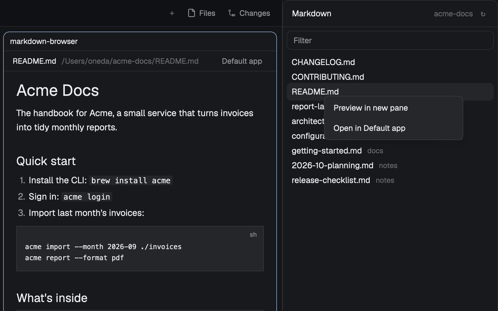

# markdown-browser



A [Herdr](https://herdr.dev) mod: find the Markdown files you're working on, preview them in a
pane, and open them in your system's default app for Markdown, on macOS, Windows and Linux.

- **Markdown panel**: the `.md` / `.mdx` / `.markdown` files around the focused terminal: its
  git repo's (tracked and untracked, not ignored), else up to four levels of its folder (hidden
  folders, `node_modules` and a home's `Library` skipped). It follows the focused terminal
  (focusing a preview keeps the list while you stay in that tab) and updates when a Markdown
  file or a `.gitignore` changes; ↻ rereads it. Type in *Filter* to narrow it: every word must
  appear somewhere in the path. In the filter, ↑ / ↓ move through the matches, Enter previews
  the chosen one, and Esc clears it. The file the tab's preview shows is highlighted.
- **Click** a file to show it in the tab's preview pane (the focused one, else the one focused
  last; a new one if the tab has none). **Right-click** for *Preview in new pane* and
  *Open in Default app*; the row stays highlighted while the menu is open.
- **Preview pane**: renders the file and reloads it when it changes. Front matter is hidden,
  and in `.mdx` files so are top-level `import` / `export` lines (not those in code blocks).
  Its header has a *Default app* button.

The default app is whatever the system opens `.md` files with: `open` on macOS,
`rundll32 url.dll,FileProtocolHandler` on Windows, `xdg-open` on Linux. To use Marked, Typora
or another app, make it the default for `.md` files in your system's settings. Only a regular
Markdown file is handed over, not a `*.md` link to a program or a folder.

## What it runs and reads

It reads only the Markdown files it lists and previews, and never uses the network. To list
and open them it runs:

| When | Program |
|---|---|
| Listing a git repo | `git rev-parse`, `git ls-files` |
| Listing a folder outside git | `find` (macOS, Linux, other machines), PowerShell `Get-ChildItem` (Windows) |
| Before opening in the default app | `sh` with `realpath` (macOS, Linux), PowerShell `Get-Item` (Windows) |
| Opening in the default app | `open`, `xdg-open` or `rundll32 url.dll,FileProtocolHandler` |

On another machine (a space from `hc machine ls`), listing runs there; opening in the default
app is off, since the app would run on this computer.

## Install

Copy `mods/markdown-browser/` to `~/.config/herdr-app/mods/`, unless a folder of that name is
already there (don't overwrite it):

```sh
test -e ~/.config/herdr-app/mods/markdown-browser && echo "markdown-browser already exists" \
  || cp -R mods/markdown-browser ~/.config/herdr-app/mods/
herdr-app check ~/.config/herdr-app/mods/markdown-browser
```

The first time Herdr sees the folder, it docks the Markdown panel at the right edge of the
shown layout, 300 px wide. Drag its edge to resize it.

To move it or show and hide it with a key, edit your layout. Herdr's own layouts are read-only
(an edit is moved aside on the next start), so clone yours first:

```sh
herdr-app do layout.clone '{"name":"main","as":"my-main"}'
```

In `layouts/my-main.json`, the panel is the block with `"content": { "mod": "markdown-browser" }`.
Move it, or give it an `"id"` (say `"markdown"`) and bind `layout.toggle` in
`~/.config/herdr-app/keys.json`:

```json
{ "global": { "cmd-shift-m": "layout.toggle:markdown" } }
```

## Key

The repo's `keys.json` has the key the mod expects. Herdr reads only your own
`~/.config/herdr-app/keys.json`, so installing the mod doesn't bind it: merge the
`"mod:markdown-browser"` section into yours (if you already use the key there, pick another):

```json
{ "mod:markdown-browser": { "cmd-shift-o": "markdown-browser.open", "ctrl-shift-o": "markdown-browser.open" } }
```

`cmd-shift-o` is for macOS, `ctrl-shift-o` for Windows and Linux. A `mod:` section only applies
while a preview has the keyboard, so it doesn't take the key from terminals.

With a preview pane focused, the key opens its file in the default app. It works in previews
opened from the panel, not in one opened from a shell (below): a mod pane isn't told its own
pane id, so only previews the panel opened (and recorded) can tell they're focused.

## Open a preview from a shell

```sh
herdr-app do pane.split '{"direction":"right","mod":"markdown-browser","props":{"file":"/path/to/README.md"}}'
```

The panel can't switch such a preview to another file in place: the first click replaces it
with one of its own.

## How often it looks

- A local repo or folder is watched: the list and previews update when files change.
- Your home folder, or a folder above it, isn't watched (that would be every file you have):
  the list is reread every 10 s.
- On another machine, the list is reread every 10 s, and a preview every 3 s while its tab is
  the shown one.

## Optional: right-click in the Files panel

Herdr's Files panel has no right-click menu, and shipped mods are read-only. If you'd rather
start from the Files panel, add one to a copy of it. The copy is yours and isn't updated with
Herdr: to pick up a newer Files panel, clone it again and repeat step 2.

1. `herdr-app do mod.clone '{"name":"files","as":"my-files"}'`
2. In `~/.config/herdr-app/mods/my-files/main.js`, add `openOverlay` to the `herdr` import,
   and in `rows()`, right after the file row's `.on_click(...)`, add:

   ```js
   .when(!entry.dir && /\.(md|mdx|markdown)$/i.test(entry.name), el => el.on_mouse_down("right", (_e, cx) => {
     cx.stop_propagation();
     // 220 wide; 12 + 32 per item tall: Preview in new pane, Open in Default app.
     openOverlay({ mod: "markdown-browser", kind: "popup", width: 220, height: 12 + 32 * 2, props: { file: `${this.root}/${path}`, on: this.on } });
   }))
   ```

3. In your cloned layout, change `"mod": "files"` to `"mod": "my-files"`.
4. `herdr-app check ~/.config/herdr-app/mods/my-files`

## License

MIT. See [LICENSE](LICENSE). [RECIPE.md](RECIPE.md) describes the mod for building it from scratch.
