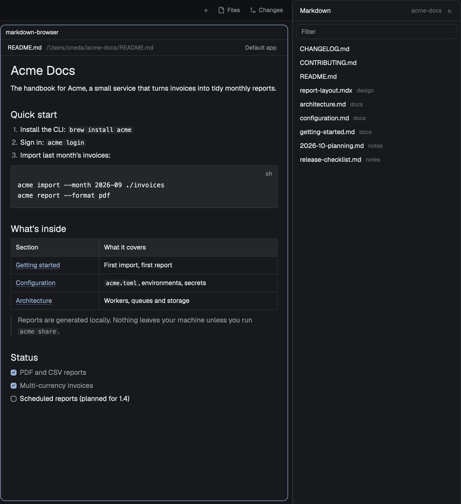

# Markdown Browser

A panel at the right edge of the window lists the Markdown files of the project the focused
terminal is in. Click one and it renders in a preview pane beside your terminals; click another
and the same preview switches to it. Right-click a file to preview it in a new pane or open it
in the system's default app for Markdown. Works on macOS, Windows and Linux, and lists and
previews files on other machines too.

## What you see

**The Markdown panel**, docked at the right edge of the window, 300 px wide. A card with a
10 px radius, a 1 px `border`-colored edge and the theme's `background`, 13 px UI text:

- **Header**, 42 px, with a 1 px bottom border: *Markdown* (semibold) on the left; on the right,
  in 12 px `dim`, the project's folder name (`machine: folder` for another machine's), then a
  `↻` that turns `foreground` on a `hover` background when pointed at.
- **Filter box**, 30 px high, 6 px in from the card's sides and top, 8 px radius, a 1 px border
  in `border`, or `accent` while it has the keyboard or holds text. Placeholder *Filter*,
  12.5 px.
- **File rows**, 28 px each, 8 px side padding, 7 px radius, 6 px around the list: the file name
  in 13 px, then its folder relative to the project in 11.5 px `dim` (top-level files first,
  then folder by folder, alphabetically). Both truncate. A vertical scrollbar appears when the
  rows overflow.
- **Messages** in place of the rows, 12 px `dim`: *Loading…*, *No folder*, *No Markdown files*,
  *No matches*, or the error from listing.

**The preview pane**, a mod pane split to the right of a terminal (or of the previous preview):

- **Header**, 32 px, 1 px bottom border, 12 px text: the file name (semibold), its full path in
  `dim` (`machine:path` for another machine's), and a *Default app* button (`muted`, 5 px
  radius, `hover` background) at the right, absent for another machine's file.
- **Body**: the rendered Markdown, 14 px, 20 px side and 14 px top padding, scrollable and
  selectable. Front matter is hidden; in `.mdx` files, top-level `import` / `export` lines are
  hidden too (not those inside a code fence). *Loading…* until the first read, or the error
  (*File not found*) in 12.5 px `dim`.

**The right-click menu**, a popup at the pointer, 220 × 76 px, `popover` background, 12.5 px:
*Preview in new pane* and *Open in Default app* (`(other machine)` appended and dimmed, not
clickable, for another machine's file). Each item is 28 px with a 6 px radius and a `hover`
background.

All colors are the theme's (`theme()`), so it follows any theme, light or dark.

## How it behaves

It shows no agents, so agent statuses (working, blocked, done, idle) don't change it.

**The list follows the focused terminal.** It shows the Markdown files (`.md`, `.mdx`,
`.markdown`, any case) of that terminal's git repo, tracked and untracked but not ignored;
outside git, up to four folder levels under its folder, skipping hidden folders,
`node_modules` and a home's `Library`. Focusing a preview pane keeps the list while you stay in
that tab; another tab, or a first look, takes the folder of that tab's first terminal.

**It stays current.** A local project is watched: adding, removing or renaming a Markdown file,
or changing a `.gitignore`, rereads it. A home folder or one above it (`/`, `/Users`, `C:\`) is
not watched (that would be every file the person has) and is reread every 10 s; so is another
machine's. A failed watch is retried after 10 s. `↻` rereads at once.

**Filter.** Typing narrows the rows to paths containing every word, in any order, any case.
While the filter has the keyboard, ↑ / ↓ move a highlighted row (`hover` color) through the
matches, wrapping, and scroll it into view; Enter previews it; Esc clears the filter. Typing
puts the highlight back on the first match.

**Click a row** to show that file in the tab's preview: the focused preview, else the one
focused last in this tab, else any; with none, a new one splits to the right of the focused
pane. The row of the file that preview shows is marked in `selected` with a semibold name.
Switching files keeps the old text on screen until the new one is read (no flash), then scrolls
to the top. Clicks are handled one at a time.

**Right-click a row** for the menu. *Preview in new pane* always opens another preview, which
gets the keyboard and becomes the tab's target. *Open in Default app* hands the file to the
system's default app for `.md` (`open`, `rundll32 url.dll,FileProtocolHandler`, `xdg-open`),
only if it is a regular Markdown file: not a folder, and not a `*.md` symlink to a program or
app bundle. A refusal or failure shows an error toast.

**The preview reloads** when its file is saved (watched locally; every 3 s for another
machine's, only while its tab is shown).

**Key.** `markdown-browser.open` (in the repo's `keys.json`: `cmd-shift-o` and `ctrl-shift-o`
under `"mod:markdown-browser"`) opens the focused preview's file in the default app.

If a new preview's pane doesn't appear within a second, an error toast says so; if the old
preview can't be replaced, a warning says it is still open beside the new one.

## Built from

- **One mod, `mods/markdown-browser/`**, no layout of its own. `mod.json`:
  `{ "place": "right", "size": 300, "title": "Markdown", "overlay": { "width": 220 } }`, so
  Herdr docks the panel at the shown layout's right edge the first time it sees the folder.
- **Three roles by props**, in `main.js`:
  - none: the panel (`initList`, `list`);
  - `{ file, on, slot? }`: a preview pane (`pane.split { direction: "right", mod, props }`);
    `on` is the machine (null here), `slot` a random id the panel gives previews it opens;
  - `{ file, on, overlay }`: the right-click menu (`openOverlay { kind: "popup", height: 76 }`).
- **`list.js`**: where to look (`spaces()`, `panes()`, `focused()`), and listing:
  `git -C <cwd> rev-parse --show-toplevel`, `git ls-files -z --cached --others
  --exclude-standard -- ':(icase)*.md' …`; outside git `find <dir> -mindepth 1 -maxdepth 4 …
  -print0`, or PowerShell `Get-ChildItem -Recurse -Depth 3` on Windows. All through
  `exec(…, { on })`, so another machine's run there.
- **`open.js`**: the file check (`sh -c 'realpath …'`; PowerShell `Get-Item`, refusing folders
  and reparse points) and the default app.
- **Herdr API**: `props`, `theme`, `spaces`, `panes`, `focused`, `home`, `window`, `exec`,
  `readTextFile`, `watchFolder`, `run` (`pane.split`, `pane.focus`, `pane.swap`, `pane.close`),
  `openOverlay`, `closeOverlay`, `notify`, `nextCommand`, `shared` / `setShared`.
- **Shared state**: `markdown-browser.slots` (`{ pane id: slot }`), `markdown-browser.show`
  (`{ slot: { file, on } }`: what each preview shows), `markdown-browser.last`
  (`{ tab: pane id }`: the last focused preview per tab).
- **gpui**: `TextView.markdown` for the body, `InputState` + `Input` for the filter,
  `v_virtual_list` + `VirtualListScrollHandle` + `Scrollbar.vertical` for the rows.
- No art, fonts or network.

## Watch out

- **A pane mod's props can't change after `pane.split`, and `props()` doesn't include its pane
  id.** To switch a preview in place, the panel tags previews it opens with a `slot`, finds the
  new pane by diffing `panes()` before and after the split, records `{ pane: slot }` in shared
  state, and points the slot at the next file through shared `show`. A preview opened any other
  way (a shell's `herdr-app do pane.split`) has no slot: it is replaced instead, and the key
  doesn't work in it.
- **Replacing a pane**: open the new one beside the old, `pane.focus` it, `pane.swap left`,
  then `pane.close` the old. Without the swap, the closed pane's room goes to the pane before it
  and each replacement halves the preview's width.
- **`run()` doesn't wait** for the command to land: poll (`cx.sleep(25)`, up to a second) for
  the new pane, then for its focus, before the next step. Serialize clicks, or two splits each
  take the other's pane.
- **Closing a popup ends its tasks**: close the menu only after the preview or the app command
  has started, not when the item is pressed.
- **Rows in a virtual list can't take `on_click`**: use the list's `on_item_click` and
  `on_item_secondary_click`, keyed by the relative path.
- **`.tooltip()` showed nothing** on these rows and the header button in testing: don't rely on
  it for hints.
- **Don't `watchFolder` a home folder or anything above it**; poll it instead.
- **Reads race**: number each read and drop any but the newest for the current file and
  machine; clear an error once a read succeeds.
- **PowerShell `-Command`** treats what follows the script as more script: pass a path as a
  single-quoted literal, doubling `'` and the typographic quotes `‘ ’ ‚ ‛` too. `exec` takes no
  environment to pass it by.
- **`$(…)` drops trailing newlines**, so a resolved path must be read with a sentinel, and the
  checked path (not the original) handed to the app. `find` output must be NUL-separated.
- Herdr's own Files panel has no right-click hook, and its tab bar's Files / Changes buttons are
  fixed: this panel can't join that stack without cloning shipped mods. The README documents an
  optional Files-panel clone; the mod doesn't depend on it.
- Herdr reads only the person's `keys.json`: the repo's must be merged by hand.
- The Windows paths (PowerShell listing, file check, `rundll32`) haven't been run on a Windows
  machine.

## Done when

- `herdr-app check ~/.config/herdr-app/mods/markdown-browser` passes.
- On first install the panel appears at the right edge, 300 px wide, without editing a layout.
- With a terminal in a git repo focused, the panel lists that repo's Markdown files and no
  ignored ones; focusing a terminal in another repo switches the list.
- Saving a new `.md` file in the repo adds its row without pressing `↻`.
- Clicking a row opens a preview to the right; clicking another switches that preview in place,
  without a flash or a change in width, and its row is marked.
- Typing in the filter narrows the rows; ↑ / ↓ / Enter preview a match from the keyboard; Esc
  clears it.
- Right-click → *Preview in new pane* opens a second preview; later clicks go to whichever
  preview was focused last in that tab.
- Right-click → *Open in Default app* opens the file in the system's default app; on a `*.md`
  symlink to a program it shows an error instead.
- Editing the previewed file updates the preview within a second.
- With a terminal in the home folder focused, the list still fills and updates within 10 s,
  and nothing watches the home folder.
